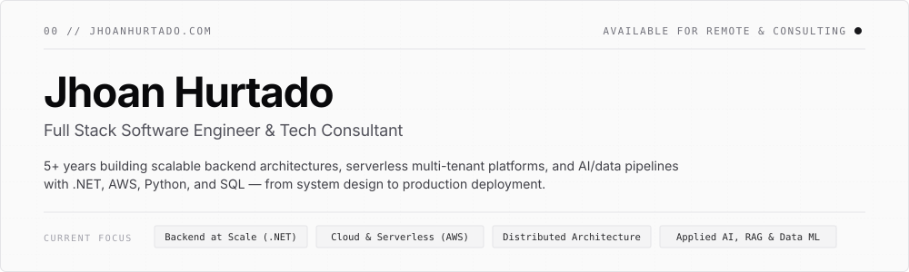

  <a href="https://jhoanhurtado.com">
    <picture>
      <source media="(prefers-color-scheme: dark)" srcset="./assets/header-dark.svg" />
      <source media="(prefers-color-scheme: light)" srcset="./assets/header-light.svg" />
      
    </picture>
  </a>

   

  

    
    
    
    
  

---

### `01` &nbsp; ABOUT & ENGINEERING PRINCIPLES

Software engineer with **5+ years of experience** building enterprise and cloud-native backend systems in **.NET and AWS** — from high-throughput distributed services to serverless, multi-tenant platforms. I design **APIs, microservices, and data/AI pipelines** that scale, taking products from architectural design to automated production deployment (`Clean Architecture`, `DDD`, `CI/CD`) and turning business data into actionable insight through **SQL, Python, and applied Machine Learning**.

> *"I aim to work on backend-focused projects where software architecture, scalability, and clean engineering practices are valued, contributing to reliable and long-term systems."*

| `01` Clean & Modular Architectures | `02` Scalable & Reliable Systems |
| :--- | :--- |
| Domain-driven boundaries, SOLID principles, and zero-dependency core layers that evolve cleanly over time. | Event-driven pipelines, asynchronous processing, and cloud-native resilience engineered for production loads. |
| **`03` Pragmatic AI & Data Engineering** | **`04` End-to-End Ownership** |
| Production RAG systems, AST-safe analytical engines, time-series forecasting, and ETL pipelines that deliver measurable value. | Full lifecycle execution across backend, frontend, infrastructure-as-code, observability, and automated CI/CD. |

---

### `02` &nbsp; SELECTED PROJECTS & CASE STUDIES

<table>
  <tr>
    <td width="50%" valign="top">
      <code>01 · FEATURED · MULTI-TENANT SAAS</code>
      <h4><a href="https://nexaflow.jhoanhurtado.com">NexaFlow — Serverless SaaS Platform</a></h4>
      

        Production-ready multi-tenant platform built with <strong>6 independent serverless microservices</strong> on AWS covering identity, Stripe billing, POS with Outbox pattern, reservations, real-time analytics, and an AI forecasting &amp; anomaly detection layer powered by <strong>Amazon Bedrock</strong> and <strong>Prophet</strong>.
      

      

        <code>.NET 10 Native AOT</code> <code>AWS Lambda</code> <code>AWS SAM</code> <code>Python / FastAPI</code> <code>React</code> <code>PostgreSQL (RLS)</code> <code>Amazon Bedrock</code> <code>GitHub Actions OIDC</code>
      

      

        <a href="https://nexaflow.jhoanhurtado.com"><code>Live Demo ↗</code></a> &nbsp;·&nbsp;
        <a href="https://github.com/JhoanHurtado/NexaFlow"><code>Source ↗</code></a> &nbsp;·&nbsp;
        <a href="https://jhoanhurtado.com/proyectos"><code>Case Study →</code></a>
      

    </td>
    <td width="50%" valign="top">
      <code>02 · FEATURED · APPLIED AI &amp; DATA</code>
      <h4><a href="https://observatorio-secop2.streamlit.app">SECOP II Citizen Observatory — Hybrid RAG &amp; ML</a></h4>
      

        Public procurement audit platform analyzing <strong>50,000+ government contracts</strong>. Combines a hybrid AI assistant (hierarchical legal RAG on <strong>Qdrant + Gemini</strong> and an <strong>AST-validated Text-to-SQL</strong> engine) with an end-to-end <strong>Scikit-Learn</strong> pipeline under strict temporal validation to predict contract risk.
      

      

        <code>Python</code> <code>Scikit-Learn</code> <code>Qdrant</code> <code>Gemini API</code> <code>RAG</code> <code>Text-to-SQL (AST)</code> <code>SQLite</code> <code>Streamlit</code> <code>Pytest</code>
      

      

        <a href="https://observatorio-secop2.streamlit.app"><code>Live App ↗</code></a> &nbsp;·&nbsp;
        <a href="https://github.com/JhoanHurtado/observatorio_secop_ii_desarrollo"><code>Source ↗</code></a> &nbsp;·&nbsp;
        <a href="https://jhoanhurtado.com/proyectos"><code>Case Study →</code></a>
      

    </td>
  </tr>
  <tr>
    <td width="50%" valign="top">
      <code>03 · FEATURED · MOBILE &amp; BACKEND</code>
      <h4><a href="https://nuvri.app">Nuvri — Cross-Platform Learning Platform</a></h4>
      

        Cross-platform vocabulary retention product built with <strong>Flutter</strong> and a modular <strong>.NET</strong> backend. Features spaced-repetition scheduling, event-driven push notification orchestration, CEFR A1–C2 discovery, gamified challenge modes, and rewarded-ad monetization launched on iOS and Android.
      

      

        <code>.NET Core</code> <code>Flutter</code> <code>PostgreSQL</code> <code>RabbitMQ</code> <code>AWS SQS / SES</code> <code>Firebase</code> <code>JWT</code>
      

      

        <a href="https://nuvri.app"><code>Live (nuvri.app) ↗</code></a> &nbsp;·&nbsp;
        <a href="https://jhoanhurtado.com/proyectos"><code>Case Study →</code></a>
      

    </td>
    <td width="50%" valign="top">
      <code>04 · DISTRIBUTED SYSTEMS</code>
      <h4><a href="https://github.com/JhoanHurtado/RetoArchitecture">IoT Fleet Telemetry Architecture</a></h4>
      

        High-throughput event-driven microservices architecture for real-time IoT telemetry and fleet management. Ingests and processes <strong>10k+ events/sec</strong> with <strong>&lt;50ms end-to-end latency</strong> using Kafka streams, asynchronous rule evaluation, and horizontal autoscaling on Kubernetes.
      

      

        <code>.NET</code> <code>Java</code> <code>Apache Kafka</code> <code>Kubernetes</code> <code>PostgreSQL</code> <code>Redis</code> <code>Event-Driven</code>
      

      

        <a href="https://github.com/JhoanHurtado/RetoArchitecture"><code>Source ↗</code></a> &nbsp;·&nbsp;
        <a href="https://jhoanhurtado.com/proyectos"><code>Case Study →</code></a>
      

    </td>
  </tr>
</table>

---

### `03` &nbsp; TECHNICAL STACK & ARCHITECTURE

#### Backend & System Design

  
  
  
  
  
  
  
  
  

#### Cloud, Serverless & DevOps

  
  
  
  
  

#### Data, Messaging & Applied AI

  
  
  
  
  
  
  
  
  
  

#### Frontend & Cross-Platform

  
  
  
  

---

### `04` &nbsp; PROFESSIONAL EXPERIENCE

| Period | Role & Company | Focus & Stack |
| :--- | :--- | :--- |
| `09/2022 – Present` | **Full Stack Developer** · *Periferia IT Group* | Enterprise backend & frontend architecture, performance optimization, production stability · `.NET` `C#` `Angular` `SQL Server` `Java` `Python` |
| `02/2022 – 08/2022` | **Development Analyst** · *Nexos Software* | Corporate web applications, evolutionary & corrective maintenance · `.NET` `Angular` `SQL Server` |
| `11/2021 – 01/2022` | **Full Stack Developer** · *Olimpia IT* | Backend microservices architecture and service scalability · `.NET Core` `Microservices` `SQL Server` |
| `07/2021 – 11/2021` | **Full Stack Developer** · *Julius Connected 2 Grow* | Full-stack feature delivery, deployments, and client engineering support · `.NET` `Angular` `SQL Server` |

---

### `05` &nbsp; EDUCATION & SPECIALIZATION

- **`IN PROGRESS`** — **Data Engineering & Artificial Intelligence** · *Universidad Autónoma de Occidente*
- **`IN PROGRESS`** — **Specialization in Artificial Intelligence** · *Corporación Unificada Nacional (CUN)*
- **`2023`** — **B.S. in Systems Engineering** · *Universidad del Pacífico*

---

### `06` &nbsp; CONTACT

Available to discuss **software architecture, backend/cloud engineering, technical consulting, or remote opportunities**.

- **Portfolio & Technical Blog:** [jhoanhurtado.com](https://jhoanhurtado.com/)
- **LinkedIn:** [linkedin.com/in/jhoan-hurtado](https://www.linkedin.com/in/jhoan-hurtado/)
- **Email:** [jhoanezequielh@gmail.com](mailto:jhoanezequielh@gmail.com)
